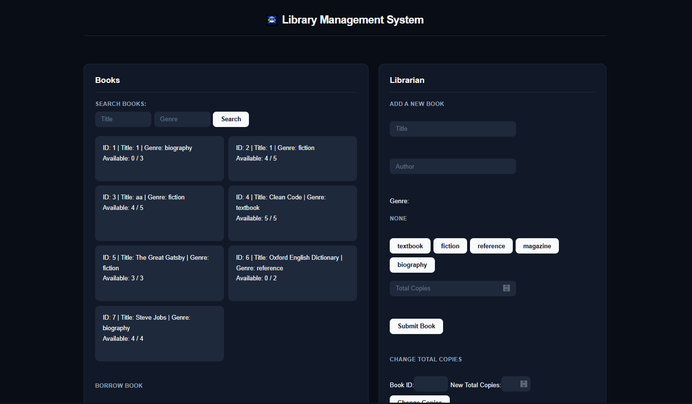

# Team 01 - Library Book Lending

| Team | Partner 1 | Partner 2 | Partner 3 | Project | Branch |
|---|---|---|---|---|---|
| 01 | Melvin | Naman Choudhary | Gokul | [Library Book Lending](https://github.com/Naman20070/lending-book-libraray-project) | `Melvin's-Branch` |

---

## 1. What to Build (Problem Statement)
The department library needs a simple system to manage book lending and returns. It can be difficult to keep track of available books, borrowed books, student details, due dates, renewals, and overdue loans. Our project aims to make this process easier by providing a system where students can borrow, renew, and return books, while the librarian can manage books and monitor overdue loans.

---

## 2. Who is Doing What (Work Distribution)

### Melvin
- **Backend:**
  - `E4`: Change a book's total copies. Copies available go up or down by the same amount.
  - `E5`: Delete a book.
  - `E6`: Borrow a book with a roll number. The borrow date is today and the due date is 14 days later.
- **Frontend:**
  - `borrowBook()` in `src/components/Books.jsx` (E6)
  - `changeTotalCopies()` in `src/components/Librarian.jsx` (E4)
  - `deleteBook()` in `src/components/Librarian.jsx` (E5)
  - Co-developed `src/App.jsx` layout & state management

### Naman Choudhary
- **Backend:**
  - `E7`: Renew a loan. The due date moves 7 days later.
  - `E8`: Return a loan. The return date is today.
  - `E9`: Get one student's loans that aren't returned, by roll number. Each one includes the book's title and the due date.
  - `E10`: Get all overdue loans, with the book's title and the roll number.
- **Frontend:**
  - `MyLoans.jsx` component: `fetchStudentLoans()` (E9), `renewLoan()` (E7), and `returnLoan()` (E8)
  - `fetchOverdue()` in `src/components/Librarian.jsx` (E10)
  - Co-developed `src/App.jsx` layout & state management

### Gokul
- **Backend:**
  - `E1`: Get all the books. Can be filtered by genre and searched by title.
  - `E2`: Get one book by its id.
  - `E3`: Add a new book: title, author, genre and total copies. Copies available start equal to total copies.
- **Frontend:**
  - `fetchbooks()` in `src/components/Books.jsx` (E1, E2)
  - `handleAddBook()` in `src/components/Librarian.jsx` (E3)

### Full Feature & Endpoint Mapping (E1 to E10)

| PRD Code | Frontend File | Frontend Function | Backend Function (`functions.py`) | Backend Endpoint (`main.py`) | Who |
|:---:|---|---|---|---|:---:|
| **E1** | `Books.jsx` | `fetchbooks()` | `get_books()` | `GET /books` | Gokul |
| **E2** | *(Backend API)* | *(called via `/books/{id}`)* | `get_one_book()` | `GET /books/{id}` | Gokul |
| **E3** | `Librarian.jsx` | `handleAddBook()` | `add_new_book()` | `POST /books` | Gokul |
| **E4** | `Librarian.jsx` | `changeTotalCopies()` | `change_total_copies()` | `PATCH /books/copies/{id}` | **Melvin** |
| **E5** | `Librarian.jsx` | `deleteBook()` | `delete_book()` | `DELETE /books/{id}` | **Melvin** |
| **E6** | `Books.jsx` | `borrowBook()` | `borrow_book()` | `POST /books/borrow/{id}` | **Melvin** |
| **E7** | `MyLoans.jsx` | `renewLoan()` | `renew_loan()` | `PATCH /loans/{id}/renew` | Naman |
| **E8** | `MyLoans.jsx` | `returnLoan()` | `return_loan()` | `PATCH /loans/{id}/return` | Naman |
| **E9** | `MyLoans.jsx` | `fetchStudentLoans()` | `get_student_loans()` | `GET /loans/student/{roll_no}` | Naman |
| **E10** | `Librarian.jsx` | `fetchOverdue()` | `get_overdue_loans()` | `GET /loans/overdue` | Naman |

---

## 3. API: 10 Endpoints (API Contracts)

Run it on port **8001**, and add CORS so the React app can call it.

| # | What it does | Method | Path | Request body | Success code | Error codes | Who |
|---|---|---|---|---|---|---|---|
| **E1** | Get all the books. Can be filtered by genre and searched by title. | get | `/books` | query parameters: genre, title | 200 |  | Gokul |
| **E2** | Get one book by its id. | get | `/books/{id}` | none | 200 | 404, 422 | Gokul |
| **E3** | Add a new book: title, author, genre and total copies. Copies available start equal to total copies. | post | `/books` | query parameters: title, author, genre, total_copies | 200 | 422 | Gokul |
| **E4** | Change a book's total copies. Copies available go up or down by the same amount. | patch | `/books/copies/{book_id}` | query parameters: new_total_copies=22 | 200 | 400, 404, 422 | Melvin |
| **E5** | Delete a book. | delete | `/books/{book_id}` | none | 200 | 400, 404, 422 | Melvin |
| **E6** | Borrow a book with a roll number. The borrow date is today and the due date is 14 days later. | post | `/books/borrow/{book_id}` | query parameters: roll_no=AU25UG034 | 200 | 400, 404, 422 | Melvin |
| **E7** | Renew a loan. The due date moves 7 days later. | patch | `/loans/{loan_id}/renew` | none | 200 | 400, 404, 422 | Naman |
| **E8** | Return a loan. The return date is today. | patch | `/loans/{loan_id}/return` | none | 200 | 400, 404, 422 | Naman |
| **E9** | Get one student's loans that aren't returned, by roll number. Each one includes the book's title and the due date. | get | `/loans/student/{roll_no}` | none | 200 |  | Naman |
| **E10** | Get all overdue loans, with the book's title and the roll number. | get | `/loans/overdue` | none | 200 |  | Naman |

---

## 4. Rules the API Must Check

| Rule | Status |
|---|:---:|
| Borrowing a book with 0 copies available | 400 |
| Borrowing when the student already has 3 loans not returned | 400 |
| Borrowing when the student has an overdue loan | 400 |
| Borrowing a book the student already has (not returned) | 400 |
| Renewing a loan that was already renewed, or that is overdue | 400 |
| Renewing or returning a loan that was already returned | 400 |
| Deleting a book that has copies out on loan | 400 |
| Lowering total copies below the number of copies out on loan | 400 |
| A book or loan id that doesn't exist | 404 |
| A missing or empty field, a genre not in the list, or total_copies not between 1 and 20 | 422 |

- Borrowing takes 1 from `copies_available`, and returning adds 1 back.
- Every error sends a clear message: `{"detail": "This student already has 3 books."}`.

---

## 5. Frontend & UI Parts (Demo Structure)

One page with three parts. Keep the API address in one place: `const API_URL = "http://127.0.0.1:8001";`

| Part | Component File | Shows | Does | Uses | Function Name in JSX | Who |
|---|---|---|---|---|---|---|
| **Books** | `src/components/Books.jsx` | a card per book: title, author, genre, copies available, and a "Not available" label; click one to see its details | genre filter and title search; roll number box + **Borrow** | E1, E2, E6 | `fetchbooks()` (E1, E2)<br>`borrowBook()` (E6) | **Gokul** (`fetchbooks`)<br>**Melvin** (`borrowBook`) |
| **My loans** | `src/components/MyLoans.jsx` | the student's loans with due dates, and an "Overdue" label | type roll number + **Show**; **Renew** and **Return** buttons | E7, E8, E9 | `fetchStudentLoans()` (E9)<br>`renewLoan()` (E7)<br>`returnLoan()` (E8) | **Naman** (All functions) |
| **Librarian** | `src/components/Librarian.jsx` | the overdue loans; a form with a genre dropdown | adds a book; a copies box + **Save** and a **Delete** button on each book | E3, E4, E5, E10 | `handleAddBook()` (E3)<br>`changeTotalCopies()` (E4)<br>`deleteBook()` (E5)<br>`fetchOverdue()` (E10) | **Gokul** (`handleAddBook`)<br>**Melvin** (`changeTotalCopies`, `deleteBook`)<br>**Naman** (`fetchOverdue`) |

---

## 6. Project File Structure

```
lending-book-libraray-project/
├── backend/
│   ├── main.py              # FastAPI app, routing, CORS & port 8001 (E1–E10)
│   ├── functions.py         # Database models, queries & rule validation logic
│   └── library.db           # SQLite database with books and loans tables
├── frontend/
│   ├── index.html           # Vite HTML entry point
│   ├── src/
│   │   ├── main.jsx         # React application root mount
│   │   ├── App.jsx          # Dashboard layout (Books, MyLoans, Librarian)
│   │   ├── index.css        # Application styling & Chrome theme sync
│   │   └── components/
│   │       ├── Books.jsx     # Part 1: Book cards, search & borrow (E1, E2, E6)
│   │       ├── MyLoans.jsx   # Part 2: Student loans, renew & return (E7, E8, E9)
│   │       └── Librarian.jsx # Part 3: Add book, copies, delete & overdue (E3, E4, E5, E10)
│   ├── package.json
│   └── vite.config.js
├── screenshot_app.png       # Application UI preview screenshot
└── README.md                # Project documentation & setup guide
```

---

## 7. Data

One SQLite file, `library.db`, with two tables.

| Table | Columns |
|---|---|
| `books` | `id`, `title`, `author`, `genre`, `total_copies`, `copies_available` |
| `loans` | `id`, `book_id`, `roll_no`, `borrowed_on`, `due_on`, `renewed` (0 or 1), `returned_on` (empty until returned) |

- **genre** must be strictly one of: `textbook`, `fiction`, `reference`, `magazine`, `biography`.
- A loan is for **14 days**. Renewing adds **7 days** to `due_on`. A loan is **overdue** when it is not returned and `due_on` is before today.
- Add **10 books** and **5 loans** to start with. Give at least one book 0 copies available, and make one loan overdue.

---

## 8. Endpoint Tracker (Completion Status)

Status: ✅ done · 🟡 in progress · ⬜ not started

| # | Method + path | Built | Rules checked in /docs | Connected to React | Who |
|---|---|---|---|---|---|
| E1 | `get /books` | ✅ | ✅ | ✅ | Gokul |
| E2 | `get /books/{id}` | ✅ | ✅ | ✅ | Gokul |
| E3 | `post /books` | ✅ | ✅ | ✅ | Gokul |
| E4 | `patch /books/copies/{book_id}` | ✅ | ✅ | ✅ | Melvin |
| E5 | `delete /books/{book_id}` | ✅ | ✅ | ✅ | Melvin |
| E6 | `post /books/borrow/{book_id}` | ✅ | ✅ | ✅ | Melvin |
| E7 | `patch /loans/{loan_id}/renew` | ✅ | ✅ | ✅ | Naman |
| E8 | `patch /loans/{loan_id}/return` | ✅ | ✅ | ✅ | Naman |
| E9 | `get /loans/student/{roll_no}` | ✅ | ✅ | ✅ | Naman |
| E10 | `get /loans/overdue` | ✅ | ✅ | ✅ | Naman |

---

## 9. How to Run

### Backend (FastAPI)
```bash
cd backend
uvicorn main:app --reload --port 8001
```
The interactive API documentation is available at `http://127.0.0.1:8001/docs`.

### Frontend (React + Vite)
```bash
cd frontend
npm install
npm run dev
```
Open `http://localhost:5173/` in your browser.

---

## 10. Application Preview



